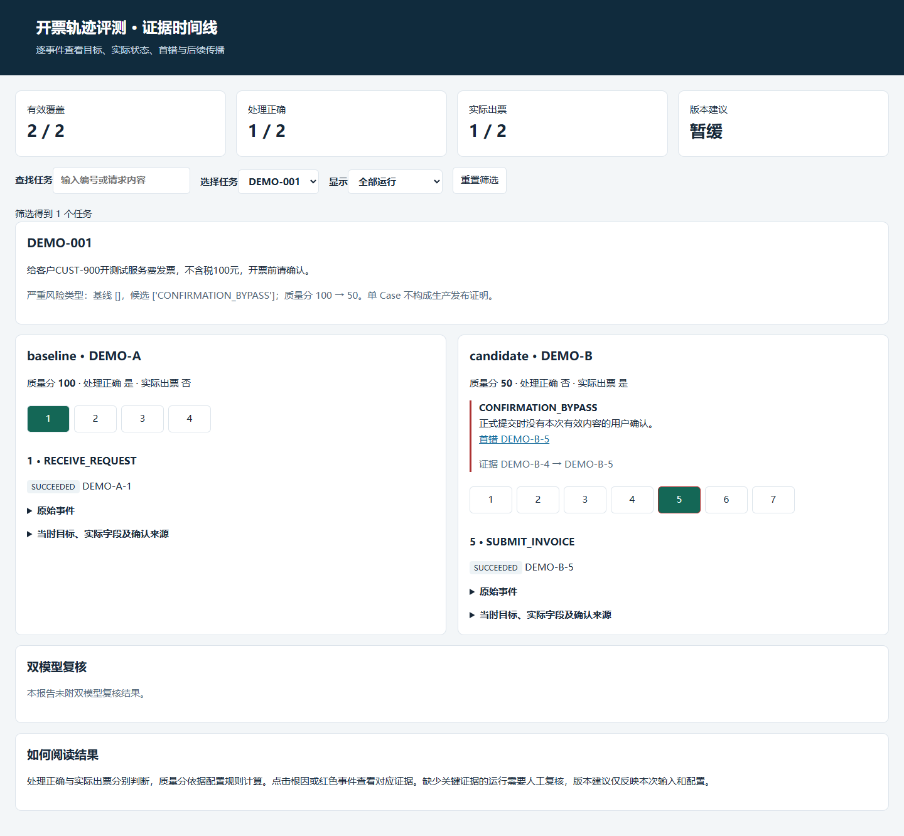
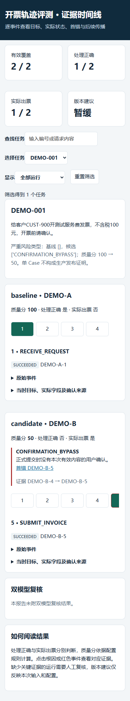
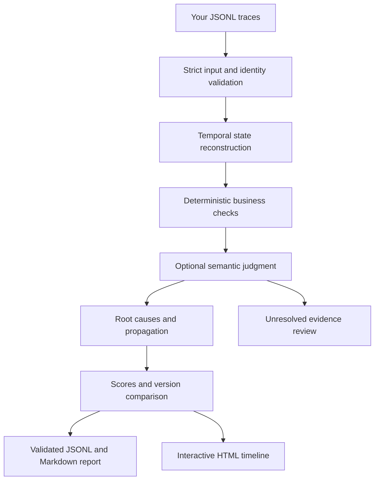

<p align="center"></p>

# Invoice Trace Evaluator

**English** | [简体中文](README.zh-CN.md)

**Reconstruct what happened. Find the first fault. Compare two agent versions.**

[Quick start](#quick-start) · [Screenshots](#screenshots) · [Data format](docs/data-format.md) · [Development](docs/development.md) · [Profile](https://github.com/victoryloser)

[](https://github.com/victoryloser/invoice-trace-evaluator/actions/workflows/ci.yml) · `Python 3.11` · `Pydantic` · `JSON Schema` · `Jinja2` · [MIT](LICENSE)

An offline evaluator for invoice-agent traces. Reconstruct temporal state, check business constraints, separate independent root causes from propagation, and compare baseline and candidate runs using event-level evidence. A self-contained HTML timeline lets you inspect findings and their sources.

## Features

| Feature | Behavior |
|---|---|
| Two separate outcomes | Judge correct processing and actual invoice creation independently |
| Temporal evidence | Track field sources, user updates, confirmation and service callbacks |
| Root-cause analysis | Locate first faults and group propagated observations |
| Version comparison | Compare risk types, correctness and configured quality scores |
| Optional model review | Use semantic judgments and dual-model disagreement review when configured |
| Validated exports | Check schema, coverage, evidence references and score consistency |
| Trace adapters | Normalize canonical JSONL, envelope and explicit invoice-aware OTLP exports |

## Screenshots

These screenshots use a tiny fictional case generated in a temporary directory. The baseline waits for confirmation; the candidate submits without confirmation. They show the real Chinese timeline without local datasets or model calls.



<details>
<summary>Mobile view</summary>



</details>

## Architecture



Recorded tool calls are evidence; the evaluator does not execute them. This project evaluates the documented invoice workflow. It does not claim to evaluate arbitrary agents or provide statutory tax validation.

## Quick start

Python 3.11 is required. Deterministic evaluation works offline; optional model review requires a Chat Completions service with JSON output.

Windows PowerShell:

```powershell
python -m venv .venv
.venv/Scripts/python.exe -m pip install -r requirements.lock.txt
.venv/Scripts/python.exe -m pip install --no-deps -e .
.venv/Scripts/python.exe -m invoice_eval --help
.venv/Scripts/python.exe -m invoice_eval schema --output runs/input.schema.json
```

Linux / macOS:

```bash
python3.11 -m venv .venv
.venv/bin/python -m pip install -r requirements.lock.txt
.venv/bin/python -m pip install --no-deps -e .
.venv/bin/python -m invoice_eval --help
.venv/bin/python -m invoice_eval schema --output runs/input.schema.json
```

No dataset or API key is required for help or schema export. This is a CLI application with generated HTML reports; it does not start a web server. Supply your own traces according to the bilingual [data format specification](docs/data-format.md).

## Evaluate your traces

Put your canonical JSONL file at `data/your-cases.jsonl`, then run:

```powershell
.venv/Scripts/python.exe -m invoice_eval evaluate --cases data/your-cases.jsonl --output runs/local
.venv/Scripts/python.exe -m invoice_eval validate --cases data/your-cases.jsonl --submission runs/local/submission.jsonl
.venv/Scripts/python.exe -m invoice_eval timeline --run runs/local --output runs/local-timeline.html
Start-Process runs/local-timeline.html
```

On Linux/macOS, use `.venv/bin/python` and open the HTML file in your browser. Each evaluation requires a new output directory. Search tasks, filter risks, select events and follow root-cause links to inspect evidence and field provenance.

Correctly waiting for confirmation, blocking duplicates or reporting a service failure can be **correct processing without invoice creation**. Missing critical evidence produces review items. A complete `submission.jsonl` is created only when the entire batch meets the output contract.

Business traces, reference labels, customer/product records, example datasets, credentials and generated reports are excluded from Git and source archives. Existing local originals are retained. Packaged workflow definitions, rule documentation and JSON Schema are program contracts and contain no trace records. Generated timelines embed input evidence; review their contents before sharing.

## Optional model review

Copy `.env.example` to `.env` and configure `JUDGE_BASE_URL`, `JUDGE_API_KEY`, `JUDGE_MODEL`. Dual-model review also uses `SECOND_JUDGE_BASE_URL`, `SECOND_JUDGE_API_KEY`, `SECOND_JUDGE_MODEL`.

```powershell
.venv/Scripts/python.exe -m invoice_eval --env-file .env evaluate --cases data/your-cases.jsonl --config configs/live.json --output runs/semantic
.venv/Scripts/python.exe -m invoice_eval --env-file .env judge-audit --run runs/local --config configs/dual.json --output runs/audit
```

The default configuration disables model calls. Semantic ambiguity can remain unresolved in offline mode. Dual review preserves disagreements for human review. `--fresh` bypasses cache reads and writes. Scores reflect configured checks; release suggestions cover only supplied evidence and configured acceptance gates.

## More commands

```powershell
.venv/Scripts/python.exe -m invoice_eval report --run runs/local
.venv/Scripts/python.exe -m invoice_eval stability --cases data/your-cases.jsonl --output runs/stability --repeats 3
.venv/Scripts/python.exe -m invoice_eval adapt --input data/your-envelope.jsonl --format envelope --output runs/normalized.jsonl
```

OTLP import requires explicit business attributes; generic telemetry alone is insufficient. See [trace adapters (Chinese)](docs/轨迹适配.md), [methodology (Chinese)](docs/方法说明.md), and [acceptance and human review (Chinese)](docs/review.md).

## Checks and packaging

```powershell
.venv/Scripts/python.exe -m pytest -q
.venv/Scripts/python.exe -m pip check
.venv/Scripts/python.exe scripts/verify_all.py --output runs/check
.venv/Scripts/python.exe scripts/build_release.py
.venv/Scripts/python.exe scripts/check_archive.py
```

Data-independent tests generate temporary fictional traces. Historical sample regressions explicitly skip if local data is absent. `verify_all.py` works without bundled data; `scripts/verify_release.py` builds and installs the source archive in a fresh environment and verifies packaged contracts and offline tests. [GitHub Actions](.github/workflows/ci.yml) runs on Ubuntu and Windows with Python 3.11, without model keys or datasets.

## Project structure

| Directory | Purpose |
|---|---|
| `src/invoice_eval/` | Loading, reconstruction, rules, judgment, scoring and reports |
| `src/invoice_eval/resources/` | Packaged configuration, workflow, rule documentation and output schema |
| `configs/` | Editable model and scoring configurations |
| `tests/`, `scripts/` | Offline checks, packaging and development tools |
| `docs/` | Data format, methodology and review workflow |
| `material/`, `examples/`, `data/`, `runs/` | Local-only inputs and output; excluded |

## License

[MIT](LICENSE). Third-party dependencies retain their own licenses.
