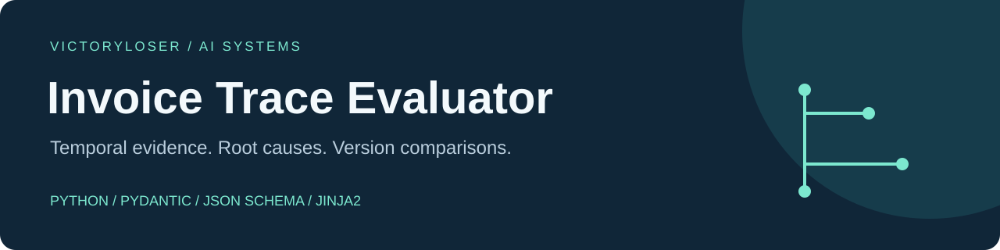
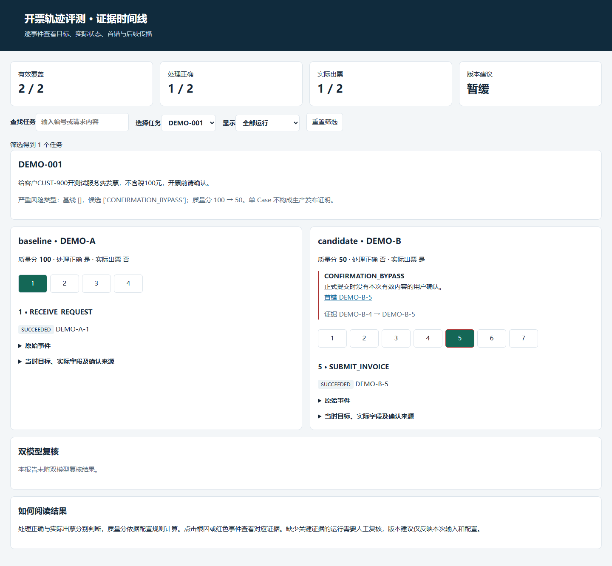
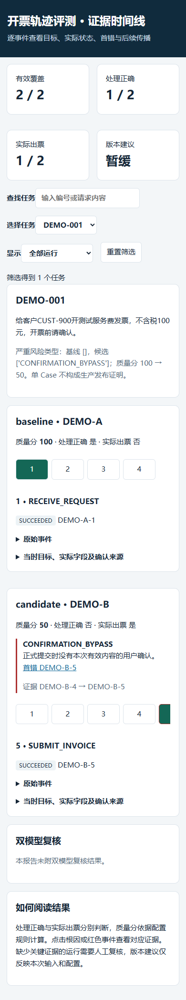

<p align="center"></p>

# 开票轨迹评测器

[English](README.md) | **简体中文**

**重建执行过程，定位首错，对比两个 Agent 版本。**

[快速开始](#安装) · [数据格式](docs/data-format.md) · [开发文档](docs/development.md) · [GitHub 主页](https://github.com/victoryloser)

[](https://github.com/victoryloser/invoice-trace-evaluator/actions/workflows/ci.yml) · `Python 3.11` · `Pydantic` · `JSON Schema` · `Jinja2` · [MIT](LICENSE)

分析开票 Agent 的离线运行记录，判断业务处理是否正确、发票是否实际生成，定位独立根因及其传播路径，并比较两个版本的表现。

## 界面预览

截图使用临时生成的微型虚构任务：基线等待确认，候选未经确认即提交。展示实际中文时间线，不读取本地数据，不调用模型。



<details>
<summary>移动端视图</summary>



</details>

## 环境要求

Python 3.11。规则评测可以离线运行；语义判断和双模型审查需要支持 Chat Completions JSON 输出的模型服务。

## 安装

在项目目录执行：

```powershell
python -m venv .venv
.venv/Scripts/python.exe -m pip install -r requirements.lock.txt
.venv/Scripts/python.exe -m pip install --no-deps -e .
.venv/Scripts/python.exe -m invoice_eval --help
.venv/Scripts/python.exe -m invoice_eval schema --output runs/input.schema.json
```

Linux/macOS：

```bash
python3.11 -m venv .venv
.venv/bin/python -m pip install -r requirements.lock.txt
.venv/bin/python -m pip install --no-deps -e .
.venv/bin/python -m invoice_eval --help
.venv/bin/python -m invoice_eval schema --output runs/input.schema.json
```

这是命令行应用，生成可直接打开的 HTML 报告，不需要启动网页服务。无数据、无模型密钥也能查看帮助和导出输入 Schema。评测前按 [中英文数据格式说明](docs/data-format.md) 准备自己的轨迹。

仓库与源码包不包含轨迹、专家标签、客户商品档案、样例数据、密钥和运行结果，本地已有文件保留。`src/invoice_eval/resources/` 仅保存必要的流程定义、规则说明、配置和 JSON Schema，不含轨迹记录。输入放入 `data/`，产物写入 `runs/`，两者均不提交。时间线嵌入本次输入证据，分享前请核对内容。

## 运行评测

输入为 UTF-8 JSONL，每行包含一个业务任务及基线、候选两个版本的运行记录，基线必须在前。每条运行携带事件、工具调用和服务结果，任务包含用户请求、上下文与终态约束。完整字段见数据格式文档；当前不支持任意 Agent 日志、CSV 或 Excel。

```powershell
$env:PYTHONUTF8='1'
.venv/Scripts/python.exe -m invoice_eval evaluate --cases data/your-cases.jsonl --output runs/local
.venv/Scripts/python.exe -m invoice_eval timeline --run runs/local --output runs/local-timeline.html
Start-Process runs/local-timeline.html
```

每次使用新的输出目录。时间线可按任务筛选，点击根因跳转到事件，查看字段来源、状态变化和两个版本的差异。

评测还自动生成 [业务行为覆盖报告](docs/behavior-coverage.md)：按版本化的 12 项清单，分别统计基线、候选“实际覆盖了哪些行为”和“哪些行为通过”，保留触发事件、处理证据和计划覆盖缺口。查看运行目录中的 `behavior_coverage.md`，或在 HTML 时间线中点击行为证据。覆盖率不等于通过率。

评测分别记录“处理是否正确”和“是否出票”：正确等待用户确认、阻断重复开票或如实处理服务失败，可以属于处理正确且未出票。缺少关键证据的运行进入复核队列。

运行目录包含结构化结论、证据、指标和 Markdown 报告。全部运行满足输出契约后生成 submission.jsonl，可供下游系统按批次读取。

## 语义判断

复制 .env.example 为 .env，并配置：

| 配置 | 含义 |
|---|---|
| JUDGE_BASE_URL / JUDGE_API_KEY / JUDGE_MODEL | 主模型服务 |
| SECOND_JUDGE_BASE_URL / SECOND_JUDGE_API_KEY / SECOND_JUDGE_MODEL | 第二模型服务 |

```powershell
.venv/Scripts/python.exe -m invoice_eval --env-file .env evaluate --cases data/your-cases.jsonl --config configs/live.json --output runs/semantic
.venv/Scripts/python.exe -m invoice_eval --env-file .env judge-audit --run runs/local --config configs/dual.json --output runs/audit
```

语义模型处理规则无法确定的问题。默认配置关闭模型调用，存在语义歧义时可能保留待复核。双模型审查比较根因、定位和证据，保留分歧供人工复核。--fresh 可关闭缓存，重新执行模型请求。质量分依据配置规则，版本建议仅覆盖当前输入与门控证据，不等于生产验证；项目也不提供法定税务核验。

## 常用命令

```powershell
.venv/Scripts/python.exe -m invoice_eval report --run runs/local
.venv/Scripts/python.exe -m invoice_eval validate --cases data/your-cases.jsonl --submission runs/local/submission.jsonl
.venv/Scripts/python.exe -m invoice_eval stability --cases data/your-cases.jsonl --output runs/stability --repeats 3
.venv/Scripts/python.exe -m invoice_eval adapt --input data/your-envelope.jsonl --format envelope --output runs/normalized.jsonl
```

支持标准 JSONL、envelope 和带业务属性的 OpenTelemetry 导出格式。适配器保留事件编号和业务证据，不执行轨迹中的工具调用。

有参考标注时，可检查[评测器本身的质量](docs/evaluator-quality.md)：

```powershell
.venv/Scripts/python.exe -m invoice_eval compare-labels --run runs/local --labels data/your-labels.jsonl --output runs/quality/label-metrics.json
```

同时生成 JSON 和 Markdown，列出各错误/风险类别的样本数、漏判率、误报率、95% Wilson 区间及分歧。缺失预测单列，基线/候选分别统计；开发集一致性不等于独立验收。

修改规则、提示词或模型后，可在同一批轨迹上进行[评测器版本回归](docs/evaluator-regression.md)：

```powershell
.venv/Scripts/python.exe -m invoice_eval compare-evaluators --old-run runs/evaluator-old --new-run runs/evaluator-new --labels data/your-labels.jsonl --output runs/regression/comparison.json
```

输出 JSON 和 Markdown，核对输入快照及产物哈希，保留缺失判定，列出判定翻转、分数与根因定位变化，并区分相对参考标注的修正和退步。可省略 `--labels`，此时只报告变化。这里的 old/new 是评测器版本，与 Case 内 Agent 的 baseline/candidate 分开。

## 项目结构

| 目录 | 职责 |
|---|---|
| src/invoice_eval/ | 加载、状态重建、规则、归因、评分及报告 |
| configs/ | 评分、模型和数据划分配置 |
| src/invoice_eval/resources/ | 打包的程序配置、流程定义、规则说明和输出契约 |
| material/、examples/、data/ | 本地输入与历史样例，不发布 |
| tests/ | 规则、协议和导出测试 |
| scripts/ | 开发检查工具 |
| docs/ | 判定方法、轨迹格式及复核流程 |
| runs/ | 评测结果和运行日志 |

## 测试

```powershell
.venv/Scripts/python.exe -m pytest -q
.venv/Scripts/python.exe -m pip check
.venv/Scripts/python.exe scripts/verify_all.py --output runs/check
.venv/Scripts/python.exe scripts/build_release.py
.venv/Scripts/python.exe scripts/check_archive.py
```

无数据测试在临时目录生成少量虚构轨迹。依赖历史样例的回归在本地材料缺失时明确跳过；不要求上传数据以通过测试。verify_all.py 可无数据执行，也可传入自己的 --cases；生成格式校验、稳定性和时间线结果。

[GitHub Actions](.github/workflows/ci.yml) 在 Windows 和 Ubuntu 使用 Python 3.11 安装锁定依赖、运行离线测试并检查源码包，无需模型密钥和数据集。`scripts/verify_release.py` 在新环境从源码包构建并安装程序，验证程序资源、无数据帮助、输入 Schema 和测试。

判定方法、适配方式与人工验收分别见 [方法说明](docs/方法说明.md)、[轨迹适配](docs/轨迹适配.md)、[验收复核](docs/review.md)。

## 许可证

[MIT](LICENSE)。第三方依赖遵循各自的许可证。
